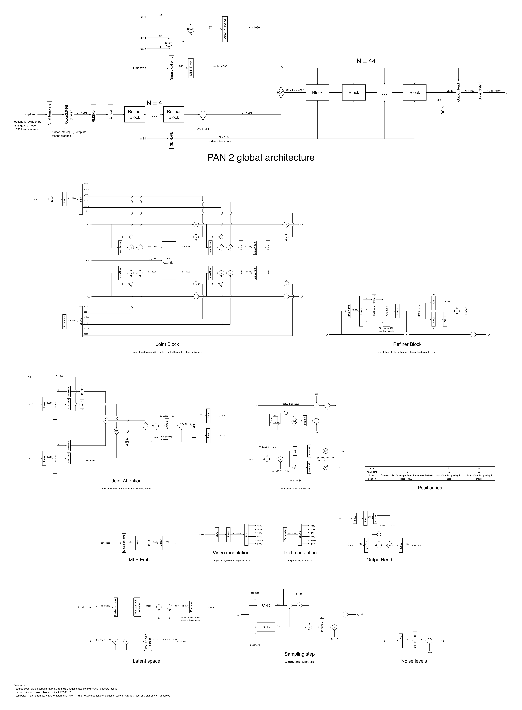

# PAN2-architecture-diagram
A detailed diagram laying out the full PAN 2 architecture as released by IFM (MBZUAI), broken down to single ML blocks.


(open the file to view it zoomed in, or use the [PDF](./diagram/pan2_architecture_diagram.pdf))

The diagram is written in [Typst](https://typst.app) with [CeTZ](https://github.com/cetz-package/cetz), every figure has its own file in `diagram/`. To rebuild it:
```sh
typst compile diagram/pan2_architecture_diagram.typ pan2_architecture_diagram.png --ppi 200
```

# A few things worth noticing
- there is only one block type, 44 joint blocks where video and text attend to each other in a single attention call but keep their own QKV, q/k norm, output projection and FFN (32768 wide for video, 16384 for text), no single stream part
- the video modulation is computed in every block from the timestep embedding (SiLU then Linear, chunked as shift, scale, gate twice), while the text stream's modulation is a learned 6 × 4096 table per block that never sees the timestep
- those modulation Linears, the timestep MLP and the text tables add up to exactly 4,482,744,320 parameters, which is the float32 part of the released checkpoint, everything else is bf16
- only the video q and k are rotated, the text tokens get no positional information inside the blocks, just a learned type vector added once after the token refiner
- RoPE pairs adjacent channels (interleaved, not split halves) over three axes of 16, 56 and 56 dims, with theta = 256 and only the frame positions rescaled (by 16/24)
- text to video and image to video are the same model, the input has 97 channels (noisy latent, condition latent, one mask channel), the condition is zero for text to video and holds the first frame latent in frame 0 for image to video, where the sampler also skips guidance on that frame
- the text encoder is a frozen Qwen3.5-9B with the last two layers and the final norm removed, so the features are the raw output of layer 30, followed by an RMSNorm, a Linear and 4 refiner blocks with a SwiGLU FFN
- the caption is a structured world state description, which the model card has an external language model (the "conceptual reasoner") write from a free text prompt, an optional step that is not part of the released weights
- the output head chunks its modulation as shift then scale, while the diffusers `AdaLayerNormContinuous` expects scale then shift, so the conversion script swaps the two halves
- the sampler is plain Euler on a sigma grid shifted by 9, with guidance 2.5 against a long structured negative caption, and the model sees `1000 * sigma` as its timestep

# References
- [PAN 2 source code](https://github.com/ifm-ai/PAN2) and the [weights](https://huggingface.co/IFM/PAN2)
- [diffusers implementation](https://github.com/huggingface/diffusers/blob/main/src/diffusers/models/transformers/transformer_pan2.py)
- [Xing, Deng and Hou, *Critique of World Model*, 2025](https://arxiv.org/abs/2507.05169)
- VAE: [Team Wan, *Wan: Open and Advanced Large-Scale Video Generative Models*, 2025](https://arxiv.org/abs/2503.20314)
- text encoder: [Qwen3.5-9B](https://huggingface.co/Qwen/Qwen3.5-9B)
- Style borrowed from my [Flux.1 architecture diagram](https://github.com/brayevalerien/Flux.1-Architecture-Diagram)
